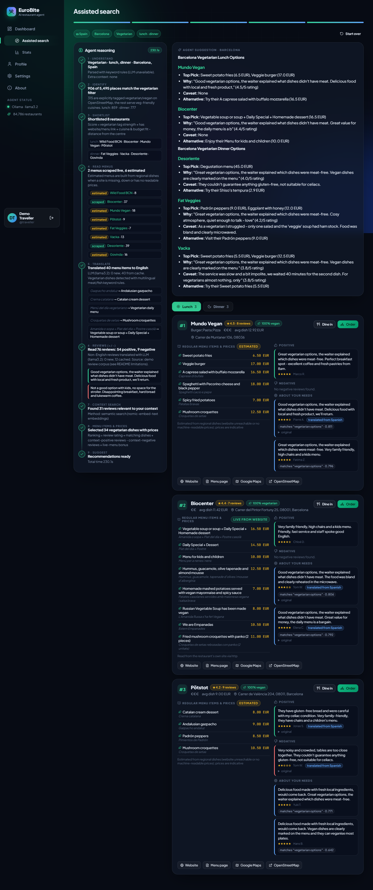
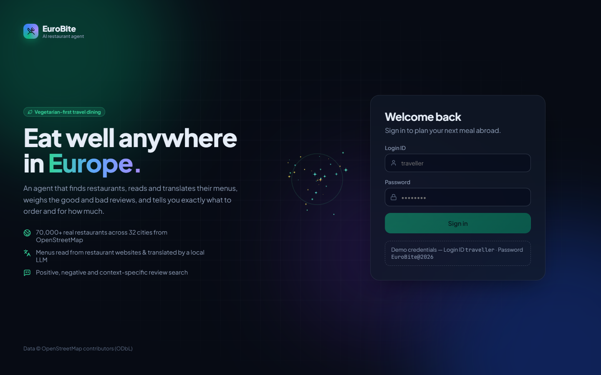
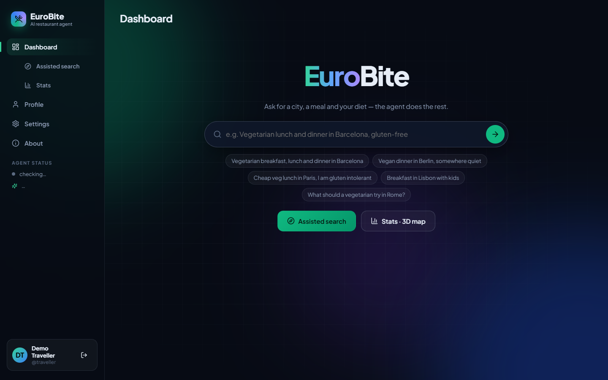
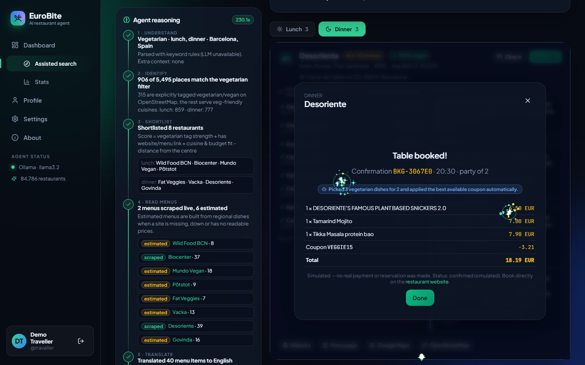
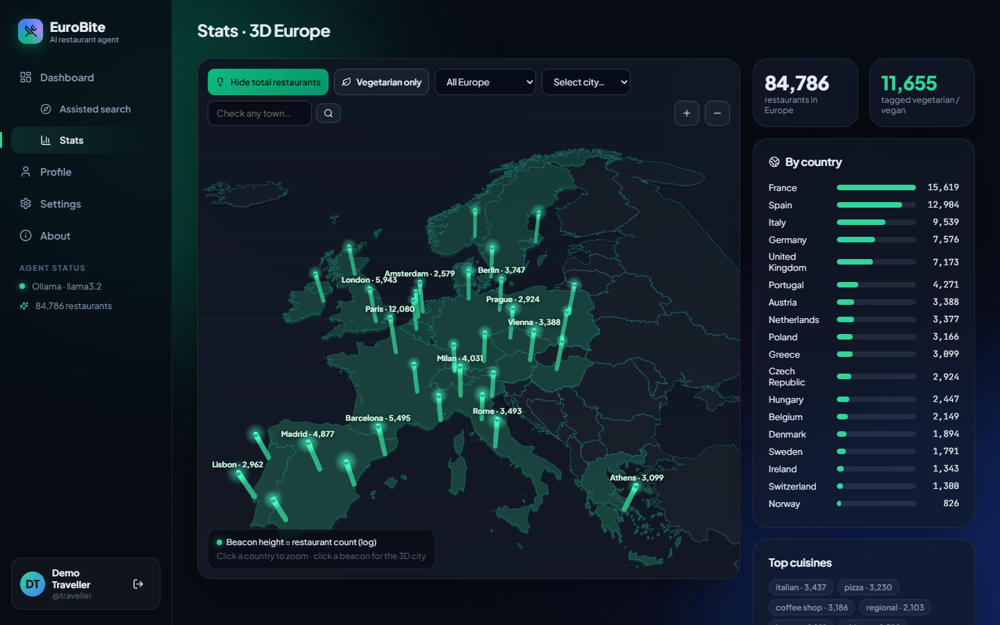
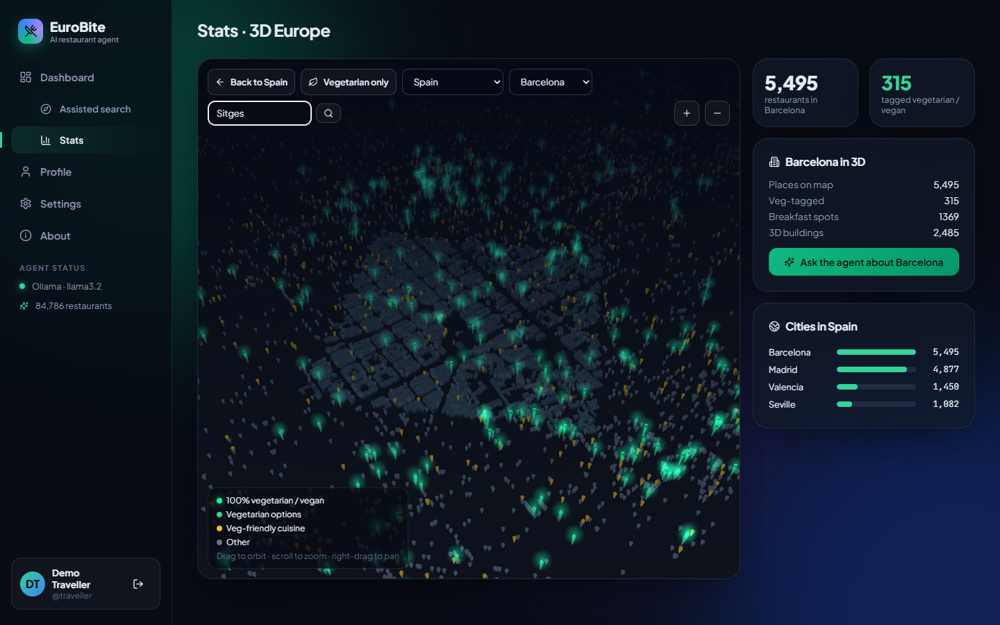
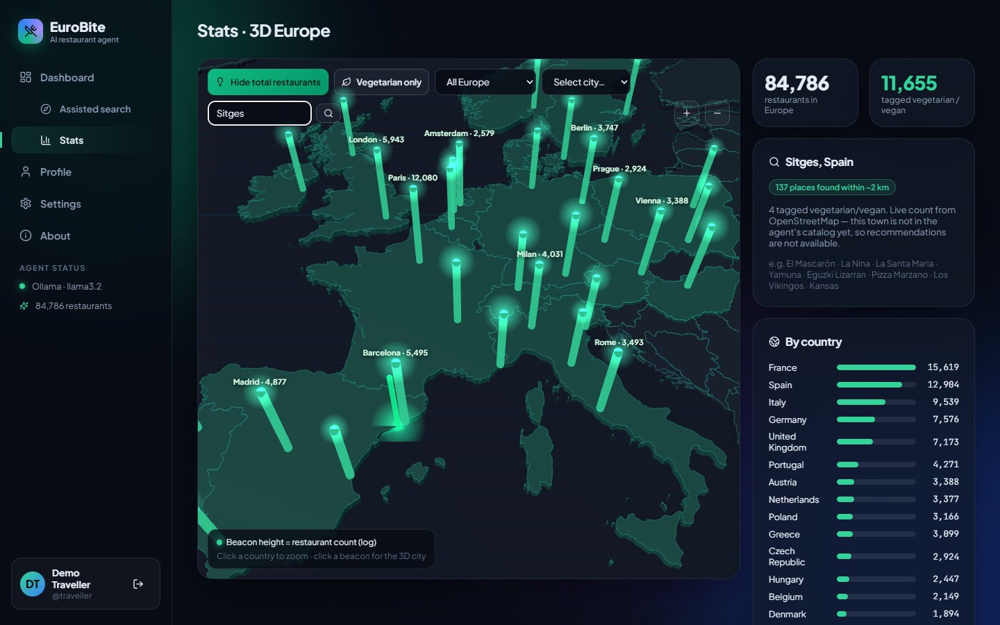

# EuroEat — AI restaurant agent for travellers in Europe

EuroEat recommends restaurants to a traveller in a European city, with a focus on
vegetarian food. The user names a city, their meals (breakfast, lunch or dinner) and any
preferences. The agent then shows each step it takes:

1. **Understand** the request: city, diet, meals, budget and extra needs such as gluten-free or kids.
2. **Identify** the restaurants in the city that fit the diet and the meal.
3. **Shortlist** the best candidates.
4. **Read each menu** from the restaurant's own website (HTML, JavaScript-rendered pages, or PDF).
5. **Translate** the menu into English with a local LLM.
6. **Read positive and negative reviews**, translated where needed.
7. **Search reviews for the user's context**, using semantic search.
8. **Show regular menu items with prices.**
9. **Suggest** options, with links to each restaurant's website and menu page.

From the results the user can **order online or book a table**. The best coupon is applied
automatically, or the agent can place the order or booking by itself (simulated).



| Login | Dashboard | Booking |
|---|---|---|
|  |  |  |

| 3D Europe | 3D cityscape (Barcelona) | Town lookup |
|---|---|---|
|  |  |  |

## Quick start

Prerequisites: Python 3.10+, Node 18+, and [Ollama](https://ollama.com) running locally.

```powershell
# Windows
./start.ps1
```
```bash
# macOS / Linux
./start.sh
```

Then open **http://localhost:5173** and sign in with:

| Login ID | Password |
|---|---|
| `traveller` | `EuroEat@2026` |

You can override these with the `EUROEAT_USER` and `EUROEAT_PASSWORD` environment variables
before the first start.

### Manual start
```bash
cd backend
python -m venv .venv && .venv/Scripts/pip install -r requirements.txt   # (bin/ on mac/linux)
.venv/Scripts/python -m playwright install chromium
ollama pull llama3.2 && ollama pull nomic-embed-text
.venv/Scripts/python -m uvicorn app.main:app --port 8000

cd ../frontend && npm install && npm run dev
```

The repository ships with `backend/data/euroeat.db`, which already contains about **84,800 real
restaurants** from **32 cities in 18 countries**. To rebuild or refresh it:
```bash
python -m app.ingest.osm                 # all cities (takes ~20 min, Overpass API)
python -m app.ingest.osm barcelona rome  # selected cities
python -m app.ingest.warm_cache          # optional: pre-translate knowledge base with the LLM
```

## Features

| Area | What it does |
|---|---|
| **Login** | JWT auth; passwords hashed with PBKDF2. Sparkle cursor trail and click bursts on every page (can be switched off in Settings). |
| **Dashboard** | A minimal, Google-style search bar for natural-language requests ("Vegan dinner in Berlin, somewhere quiet"), plus example prompts. |
| **Agent trace** | A live timeline of all 9 steps, streamed over Server-Sent Events. It shows the shortlist, which menus were scraped live and which were estimated, sample translations, and review samples. |
| **Results** | Results are grouped into breakfast, lunch and dinner tabs. Each restaurant card shows its menu items and prices (original and English), a positive review, a negative review, reviews about your needs, and links to the website, menu page, Google Maps and OpenStreetMap. |
| **Assisted search** | A guided wizard: country → city → veg / vegan / non-veg → meals → agent results. |
| **Order / book** | Choose order online or dine in, then dishes, party size and time slot. Every coupon is evaluated and the best one is highlighted. Or click **"Let the agent order/book automatically"**: it picks diet-appropriate dishes (no drinks or alcohol) and the best coupon. |
| **Stats · 3D map** | A three.js extruded map of Europe with glowing city beacons. "Show total restaurants" lights up all cities; there is a vegetarian-only filter; select a country to zoom in; click a city for a **3D cityscape** built from real OpenStreetMap building footprints, with every restaurant as a colour-coded pin. **"Check any town"** geocodes any European town and live-counts its restaurants. |
| **Profile** | Profile details, order and booking history, and money saved with coupons. |
| **Settings** | Experience toggles, recommendation preferences, LLM status and installed models, and data info. |
| **About** | The pipeline, the stack, the data sources, and the limitations. |

## Architecture

```
frontend/  React 19 + TypeScript (Vite), three.js, react-router, lucide icons
  src/pages/        Login, Dashboard, AssistedSearch, Stats, Profile, Settings, About
  src/components/   AgentTrace, RunView, RestaurantCard, OrderModal, SparkleCursor, Layout
  src/three/        StatsScene.ts  (Europe map + cityscape)
backend/   Python FastAPI + SQLite
  app/agent/pipeline.py   the 9-step agent (async generator → SSE events)
  app/scrape/menu.py      menu reader: httpx → Playwright (JS sites) → pypdf (PDF menus)
  app/ingest/osm.py       OpenStreetMap / Overpass ingester (tiles dense cities automatically)
  app/llm.py              Ollama client: chat, JSON intent, batch translation, embeddings
  app/knowledge/          regional dish knowledge base, demo review corpus
  app/coupons.py          coupon rules engine
  app/buildings.py        building footprints for the 3D cityscape
  data/euroeat.db        restaurants, menus, reviews, translation cache, buildings, users, orders
```

**Why Python for the backend:** the AI and scraping ecosystem (Playwright, BeautifulSoup, pypdf,
Ollama clients) is strongest in Python, and FastAPI makes streaming the agent's steps simple.
**Why SQLite:** the app runs with zero setup and the database ships with the repo. Indexed
queries over the ~85k rows take milliseconds, and the schema ports directly to Postgres.

### How the agent decides
- **Identify:** places are filtered by OSM tags (`diet:vegetarian` / `diet:vegan` = yes or only,
  then veg-friendly cuisines), and by meal: breakfast means cafés, places tagged `breakfast`, or
  opening before 10:00; dinner means open after 21:00.
- **Shortlist score** = veg-tag strength + website / menu link available + cuisine and budget
  fit − distance from the centre.
- **Final ranking** = average review rating + number of matching dishes + reviews praising the
  user's context − reviews criticising it + a bonus for a live (scraped) menu.
- **Context search:** the user's needs become queries ("gluten-free coeliac", "kids
  high chair"…). These are matched against review embeddings (`nomic-embed-text`, cosine ≥ 0.62),
  with keyword matching as a fallback.
- **Grounded suggestion:** the LLM sees only the JSON the pipeline collected and is told not to
  invent restaurants or prices.
- **Graceful degradation:** if Ollama is down, every LLM step falls back to rules, the glossary,
  or keyword search, and the UI says which method was used.

## Assumptions
1. **"Vegetarian"** at restaurant level comes from OSM diet tags, then veg-friendly cuisines
   (Indian, Italian, Middle Eastern…). At dish level, a dish is non-vegetarian if its original
   or translated name contains a meat or fish keyword (multilingual list). Fully vegetarian
   restaurants count all their dishes as vegetarian.
2. **Meals** are inferred from opening hours and venue type, because OSM has no meal-service tags.
3. **City coverage** is the central area of each city (a ~7×8 km box around the centre), where
   travellers mostly eat.
4. **Price level** is estimated (€–€€€€) when OSM has no price information.
5. **Coupons** are a fixed demo rule set (welcome, veggie, dine-in weekday lunch, early-bird,
   free delivery, partner). "Partner" restaurants are a deterministic 25% sample.
6. **Ordering and booking** are simulated. A confirmation code is stored, but no payment or
   real reservation happens.
7. One demo user is seeded on first start.

## Limitations
- **Reviews are a synthetic demo corpus.** Google, TripAdvisor and Yelp offer no free review
  API, and their terms forbid scraping. The corpus is deterministic and multilingual
  (Spanish, French, Italian, German, English) and labelled `demo-synthetic` in the data. The
  pipeline (positive/negative split, translation, semantic context search) works unchanged if
  real reviews are written to the `reviews` table.
- **Many restaurant websites are dead, image-only, or list no prices.** In a Barcelona test,
  4 of 12 shortlisted menus could be scraped live. The rest fall back to an **estimated** menu
  from a regional dish knowledge base. These are always labelled "estimated" with the reason.
  Image-only menus (photos, Instagram) are not read; OCR would be the next step.
- **Speed:** with a CPU-only Ollama, a cold run takes about 3–5 min, mostly menu scraping and
  first-time translation. Translations and menus are cached, so repeat runs are much faster.
  A GPU, or a smaller `EUROEAT_NUM_CTX`, speeds up the LLM.
- **llama3.2 (3B) translations** are good but not perfect: for example, "Cappuccino" can come out
  as "coffee with milk". Set `EUROEAT_MODEL=gpt-oss:20b` for higher quality at lower speed.
- **OSM data** can be stale or incomplete: missing websites, outdated hours, missing diet tags.
- **The Overpass and Nominatim public APIs** are rate-limited. The ingester retries and splits
  dense cities into tiles, but a full refresh can still hit temporary 504s.
- **Building footprints** for the 3D cityscape are fetched for about a 1.4 km area around the
  city centre and cached. Restaurant pins cover the whole ingested area.
- **"Check any town"** gives a live count only. Full recommendations need the town to be
  ingested (`python -m app.ingest.osm` with the town added to `app/cities.py`).

## Configuration (backend env vars)
| Variable | Default | |
|---|---|---|
| `EUROEAT_MODEL` | `llama3.2` | Ollama chat model |
| `EUROEAT_EMBED_MODEL` | `nomic-embed-text` | embedding model for review search |
| `EUROEAT_NUM_CTX` | `4096` | LLM context window |
| `OLLAMA_URL` | `http://localhost:11434` | |
| `EUROEAT_USER` / `EUROEAT_PASSWORD` | `traveller` / `EuroEat@2026` | demo login |
| `EUROEAT_SECRET` | dev value | JWT signing secret; **change it in production** |

## Data & licences
Restaurant and building data © OpenStreetMap contributors, ODbL. The Europe outline
GeoJSON is from `leakyMirror/map-of-europe`. Menus are read from restaurants' own public websites
at low volume, for a demo only.
